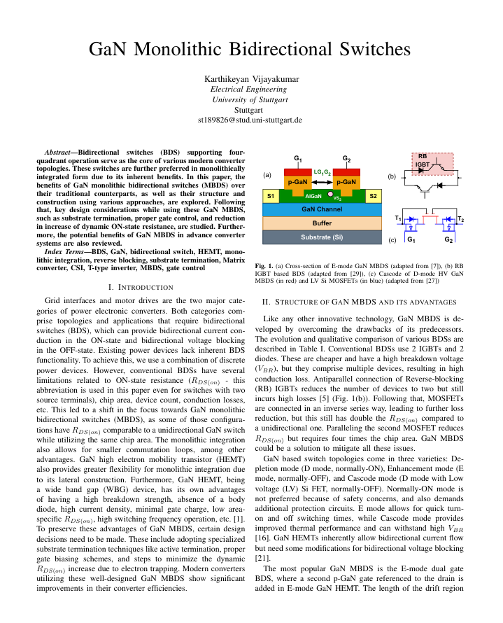

## Literature Review Report

<strong>GaN Monolithic Bidirectional Switches</strong>

A technical review exploring GaN monolithic bidirectional switch structures, operating principles, design considerations, and applications in advanced power converters.

